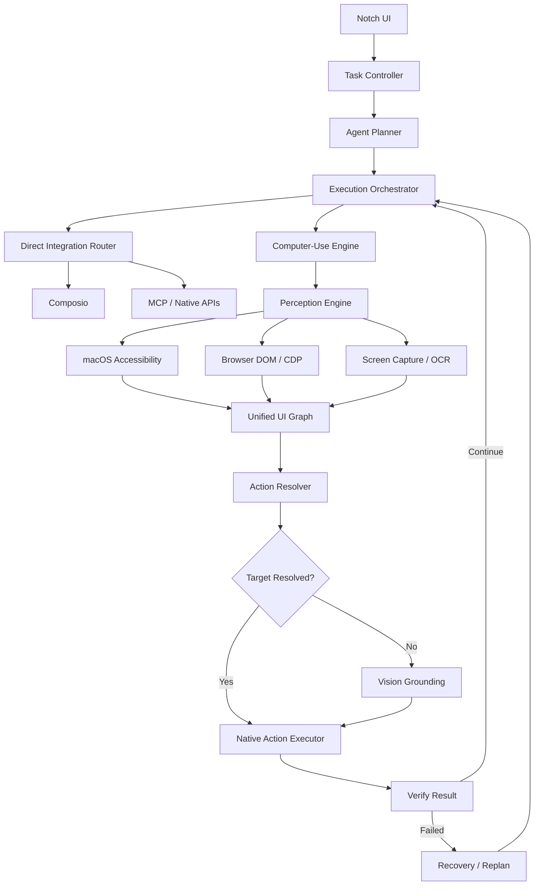

# Product Requirements Document
# Glide — Native macOS Computer-Use Agent

**Version:** 1.0
**Status:** Development-ready specification
**Platform:** macOS
**Distribution:** Open source
**Primary UI:** BoardUI
**Integrations:** Composio, MCP, native macOS automation
**AI providers:** OpenAI, Anthropic, and configurable OpenAI-compatible endpoints

> Implementation notes (added during development) are marked **[Impl]**; see ARCHITECTURE.md and docs/LIMITATIONS.md for how each requirement was met.

---

## 1. Product Overview

### 1.1 Vision

Build a lightweight, native macOS AI agent that lives in the MacBook notch and can autonomously operate the user's computer.

The user describes what they want done, presses a single button, and watches the actual mouse cursor navigate applications, click buttons, type text, scroll, switch windows, and complete the requested task.

The application should feel like an integrated macOS capability rather than a traditional AI chatbot.

### 1.2 Product Principles

1. **One-click execution:** Enter a task, press Start, and the agent begins.
2. **Native-first:** Built specifically for macOS using native frameworks.
3. **Accessibility-first:** Prefer structured UI elements over screenshot-based interaction.
4. **Vision as fallback:** Use visual understanding only when structured methods cannot reliably complete the action.
5. **Fast execution:** Minimize model round trips and unnecessary screenshots.
6. **Bring your own keys:** Users configure AI provider credentials inside the application.
7. **Open source:** No mandatory proprietary backend or developer-owned API credentials.
8. **Transparent control:** Users can observe, pause, stop, and approve agent actions.
9. **Local-first:** Execute computer actions on the user's Mac.
10. **Extensible:** Support integrations, MCP servers, reusable workflows, and future automation capabilities.

### 1.3 Non-Goals

The initial version is not intended to be a general-purpose chatbot, a full enterprise agent management platform, a cloud-hosted remote computer, a replacement operating system, a multi-user collaboration workspace, a complete browser automation IDE, or an Electron application. The product should remain a focused computer-use utility.

---

## 2. User Experience

### 2.1 Primary Interaction

The application runs persistently in the macOS menu-bar environment, with its primary interface visually attached to the MacBook notch.

1. User clicks the notch or presses a configurable keyboard shortcut.
2. A compact input interface expands.
3. User types an instruction.
4. User presses Enter or clicks Start.
5. Agent interprets the instruction and begins execution.
6. The actual system cursor moves and interacts with applications.
7. The notch displays live progress.
8. Agent completes the task and shows a confirmation.

Example instruction: "Open Safari, search for the latest Apple earnings, summarize the results, and save the summary in Notes." The agent should be able to launch Safari, navigate to a website, search and inspect content, extract relevant information, open Apple Notes, create a note, enter the summary, verify the note was created, and report completion.

### 2.2 Notch Interface States

- **A — Idle:** minimal notch appearance; no distracting animations; small status indicator when appropriate; click or shortcut to expand.
- **B — Expanded:** compact floating panel; task input; Start; optional microphone; settings access; recent tasks access.
- **C — Planning:** animated status indicator; "Understanding your task..."; Cancel.
- **D — Executing:** collapsed or minimally expanded notch; activity indicator; current action description; Pause; Stop; optional detailed activity view.
- **E — Approval Required:** notch expands automatically; displays proposed action and target; Approve, Reject, Stop; agent waits.
- **F — Completed:** success indicator; short result summary; optional View Details; auto-returns to idle after a configurable interval.
- **G — Error:** plain-language explanation; Retry, Replan, or Stop; execution history preserved.

### 2.3 Cursor Behavior

Control the actual macOS system cursor: move to identified elements; left, double, right click; scroll vertically and horizontally; drag and drop; type text; press keyboard shortcuts; switch applications; focus windows; navigate menus; select text. Movement should be observable but not artificially slow. **Fast Mode** moves directly with minimal delay; **Visual Mode** animates briefly. Fast Mode should be the default after onboarding.

### 2.4 Keyboard Shortcuts

Configurable and checked for conflicts. Open agent: Option + Space. Pause/resume: configurable. Emergency stop: configurable global shortcut that remains functional even if the main UI is hidden.

---

## 3. UI and Design System

### 3.1 BoardUI Requirement

Use BoardUI (boardyui.com) as the primary design reference and component system. Inspect its documentation and components; determine which are compatible with native SwiftUI; reproduce the necessary components in SwiftUI when direct reuse is impossible; preserve its interaction patterns and visual consistency; do not introduce a full web runtime merely to reuse UI components. Do not assume BoardUI components are natively compatible with SwiftUI.

**[Impl]** boardyui.com doesn't resolve; BoardUI is at boardui.com (React/Tailwind). Re-created natively as BoardKit — see docs/DESIGN.md.

### 3.2 UI Components

Notch pill; expandable notch panel; task input; Start; Pause/resume; Stop; status indicators; progress animation; activity timeline; approval dialog; settings navigation; provider configuration; API key input; integration cards; model selector; permissions onboarding; error and retry views; recent task history.

### 3.3 Notch Behavior

AppKit window management with SwiftUI content. Position relative to the display's actual notch/safe-area geometry; support MacBooks with and without a notch; menu-bar fallback; multiple displays; avoid obstructing system menus or notifications; correct placement when displays change; light and dark appearance; avoid permanently stealing keyboard focus; restore focus after submitting a task. The notch is a visual placement target, not a private macOS API integration.

---

## 4. Technical Architecture

### 4.1 Recommended Stack

| Layer | Technology |
|---|---|
| Application | Swift 6 |
| UI | SwiftUI + AppKit |
| Design system | BoardUI-inspired native components |
| macOS accessibility | AXUIElement |
| Mouse and keyboard | Quartz CGEvent |
| Screen capture | ScreenCaptureKit |
| OCR | Apple Vision |
| Local image processing | Core Image / Core ML as needed |
| Browser automation | Accessibility + optional CDP/browser extension |
| Agent runtime | Swift async/await |
| AI providers | OpenAI, Anthropic, compatible APIs |
| Fast action selection | Configurable small model |
| Integrations | Composio |
| Extensibility | MCP |
| Local persistence | SQLite |
| Secrets | macOS Keychain |
| Logging | OSLog + local structured event store |
| Packaging | Signed and notarized macOS application |

### 4.2 High-Level Architecture



### 4.3 Architectural Boundaries

Separate modules: NotchUI, SettingsUI, TaskController, AgentPlanner, ExecutionOrchestrator, AccessibilityEngine, PerceptionEngine, ElementGraph, ActionResolver, NativeActionExecutor, BrowserAdapter, VisionGrounding, VerificationEngine, RecoveryManager, ProviderManager, CredentialStore, ComposioIntegration, MCPManager, TaskHistory, PermissionManager. Keep the UI independent from the automation implementation.

---

## 5. Universal Computer-Use Engine

### 5.1 Supported Environments

Eventually: native macOS apps, Electron apps, web browsers, Finder, system dialogs, productivity apps, Terminal, file management interfaces, multiple windows. Initial priority: Finder, Safari/Chrome, Notes, TextEdit, and common system dialogs.

### 5.2 Perception Priority

1. Direct APIs and integrations (APIs, MCP tools, filesystem APIs, Composio actions).
2. Accessibility tree (roles, names/descriptions, values, bounds, enabled, focus, actions, hierarchy).
3. Browser DOM (semantic elements, labels, roles, selectors).
4. Indexed UI skeleton (compact structured data).
5. Local OCR (Apple Vision).
6. Screenshot-based grounding with a vision-capable model.

### 5.3 Unified Element Graph

Each element includes when available: stable local identifier, application, window, role, accessible name, value, bounding rectangle, supported actions, visibility, enabled state, parent identifier, source type, observation timestamp, confidence, locator/native reference. Ids are scoped to the current observation and refreshed when invalidated. Don't assume a target remains valid after navigation or window changes.

### 5.4 Local State Cache

Snapshot caching; incremental updates; window-change detection; focus-change detection; element identity continuity; cache invalidation; target revalidation before execution. Avoid sending full UI trees to the model unnecessarily.

### 5.5 Native Action Executor

```swift
enum ComputerAction {
    case click(ElementTarget)
    case doubleClick(ElementTarget)
    case rightClick(ElementTarget)
    case typeText(String)
    case keyPress(KeyCombination)
    case scroll(ScrollDirection, amount: Double)
    case drag(ElementTarget, ElementTarget)
    case focus(ElementTarget)
    case launchApp(String)
    case activateApp(String)
    case waitFor(WaitCondition)
}
```

Support semantic element targets and verified screen-coordinate targets. Prefer native accessibility actions where supported; use CGEvent input where necessary and permitted.

### 5.6 Verification

Verify after each meaningful action (window opened, button disappeared, dialog closed, value changed, file appeared, navigation completed, app active). Avoid relying exclusively on screenshot comparisons. Verification proportionate to risk and uncertainty.

---

## 6. AI Agent Architecture

### 6.1 Planner

Receives instruction, application context, supported tools, integration availability, recent execution history, safety policies; creates an executable, revisable plan.

### 6.2 Fast Action Selection

A small, fast model chooses between candidate UI elements when deterministic matching is insufficient, given objective, compact candidate list, recent history and app state. Avoid screenshots for ordinary accessible controls. Support Jev as a configurable candidate model where its API permits; don't hardcode the architecture to Jev.

**[Impl]** Jev is TypeSafe's System One model (calibrated Choice questions); optional, used only to disambiguate close candidates.

### 6.3 Vision Grounding

A separate vision-capable provider for canvas controls, unlabeled icons, custom widgets, incomplete accessibility trees and ambiguous elements. Validate responses against screen geometry and app state before injecting input.

### 6.4 Model Routing

Separate model selection for planning, fast action selection, vision grounding and recovery; plus an automatic routing mode for nontechnical users.

### 6.5 Execution Loop

Interpret goal → select strategy → observe → resolve next action → check safety → execute → verify → update state → continue or replan → report. Never continue indefinitely without progress: configurable step limits, timeouts, retry limits and loop detection.

---

## 7. Composio Integrations

Optional integration layer (Gmail, Google Calendar, Drive, Outlook, Slack, Notion, GitHub, HubSpot, others). Prefer a direct integration over GUI automation when appropriate; otherwise offer the UI route. Integrations settings: connected/available services, status, connect/disconnect, permission info, auth errors. In-app Composio credential field stored in Keychain; never embed developer-owned credentials; follow Composio's current SDK/security model; don't embed confidential OAuth client secrets. Composio must remain optional. The orchestrator selects between Composio, MCP, native OS operation, browser automation, accessibility-driven and vision-driven actions, and records the route in history.

---

## 8. API Key Management

Users enter keys in the app — no `.env` files, no terminal configuration, no hosted account. Providers: OpenAI, Anthropic, OpenAI-compatible endpoints, Composio. Settings › AI Providers per provider: name, key field, show/hide, save, test connection, remove, model selection, optional base URL, connection status; keys masked by default. Keys in Keychain; never in SQLite, logs, screenshots, prompts or analytics; never committed; not exposed to arbitrary tools; revocable. First-run onboarding: welcome, capabilities, permissions, provider, key, test, default model, safe introductory task; no Composio setup required.

---

## 9. Permissions and Safety

Permissions: Accessibility, Screen Recording, Automation, Microphone (voice) — requested only when necessary, with a permissions status screen. Risk levels: low (open apps, navigate, read, search files), medium (edit documents, move files, update records, drafts), high (send messages/emails, delete, publish, purchase, change security settings, destructive shell commands) — high-risk actions require explicit approval. Reliable global emergency stop that cancels pending decisions, stops input injection, cancels queued tool actions, prevents new external actions and marks the task stopped. Protections for password fields, authentication dialogs, payment information, private windows, credentials and user-excluded apps; redaction and context exclusion; no silent screenshot transmission without disclosure and consent.

---

## 10. Task History and Observability

Locally stored per task: id, instruction, start/end, status, actions, model calls, errors, recovery attempts, total latency, estimated tokens and cost. Human-readable activity view. No screenshots retained by default. Controls to clear history and delete diagnostic data.

---

## 11. Performance Requirements

| Metric | Target |
|---|---|
| Notch opening | Under 150 ms |
| Cached element lookup | Under 10 ms |
| Accessibility snapshot | Under 150 ms for typical windows |
| Simple deterministic action | Under 250 ms excluding app response |
| Time to first action | Under 2 seconds for straightforward tasks |
| Screenshot usage | Minimize through structured perception |
| Local idle CPU usage | Near zero |
| Idle memory | Minimize and measure |

Optimizations: async model calls, cached AX state, incremental updates, event-driven observation, batched extraction, deterministic actions when unambiguous, small model inputs, conditional screenshots, readiness detection instead of fixed delays, reusable validated workflow segments. Never sacrifice correctness for latency.

---

## 12. Reusable Skills

Save successful workflows as skills (name, description, parameters, preconditions, action sequence, verification rules, approval requirements, compatible apps); editable and removable; never replay stale coordinates. Initial release may implement storage and manual reuse; demonstration-based learning later.

---

## 13. Development Phases

1. **Native App Foundation** — app, notch panel, menu-bar fallback, BoardUI-inspired components, settings, provider configuration, Keychain, permissions onboarding, global shortcut, start/stop. *Acceptance: launches, configurable without env vars, shows the notch.*
2. **Native Computer Use** — AX inspection, app/window discovery, element graph, mouse, clicks, keyboard, scrolling, window switching, verification. *Acceptance: deterministic multi-step workflow across Finder and Notes.*
3. **AI Execution** — planner, provider adapters, structured action schemas, action selection, loop, recovery, limits, progress. *Acceptance: natural-language task triggers a verified multi-step workflow.*
4. **Visual Fallback** — ScreenCaptureKit, OCR, vision adapter, grounding, coordinate validation, redaction. *Acceptance: interacts with controls lacking usable AX metadata.*
5. **Browser and Integrations** — browser AX, optional extension/CDP, Composio, MCP, integration settings, tool routing. *Acceptance: authorized cross-app workflow using direct integration and computer use.*
6. **Performance and Reliability** — incremental graph, candidate ranking, fast routing, recovery, metrics, skills foundation, regression benchmarks. *Acceptance: measured improvement without reducing success.*

---

## 14. Testing and Evaluation

Repeatable suite: open an app; create a note; save a TextEdit document; rename a file in Finder; navigate a browser page; fill a web form; switch apps; interact with a system dialog; recover from a missing element; stop mid-execution; request approval before a sensitive action; handle an inaccessible or ambiguous control. Record success, actions, duration, model calls, vision calls, interventions, recoveries, estimated cost. Use safe fixtures and disposable data only.

---

## 15. Open-Source Requirements

No hardcoded secrets, no mandatory proprietary backend, no developer-owned keys, documented build, clear dependency licenses, local-first defaults, provider abstraction, optional integrations, reproducible setup, example configuration without credentials, CI build and test. Include README, LICENSE, CONTRIBUTING, ARCHITECTURE, SECURITY, PRD, docs/, automated tests. MIT or Apache-2.0 after verifying compatibility. No proprietary assets or unlicensed BoardUI source.

---

## 16. Definition of Done

A user can: install and launch; open from the notch or menu bar; enter an OpenAI or Anthropic key in Settings; grant permissions; enter a task; press Start; watch the real cursor operate native apps; complete a multi-step workflow; see verified completion; pause or stop safely; review local history; use the core app without Composio or any proprietary backend. The deliverable is a functional application, not a UI-only prototype.

---

## 17. Instructions (summary)

Build a real, compilable Swift/SwiftUI app; use BoardUI as the verified design reference; prioritize accessibility over screenshots; real cursor and keyboard control; Keychain for keys; no env vars; Composio optional; modular engine independent of UI; functional end-to-end task before advanced features; real implementations, not mocked success; error/permission handling, cancellation and verification; tests for core automation; document limitations honestly; open-source ready; no unnecessary dashboards, cloud services or auth systems.

**First milestone:** lives in the notch, opens with a shortcut, accepts an API key, accepts an instruction, plans with a configured model, reads the AX tree, identifies a target, moves the real cursor, clicks or types, verifies, shows progress in the notch, and can be stopped immediately.
