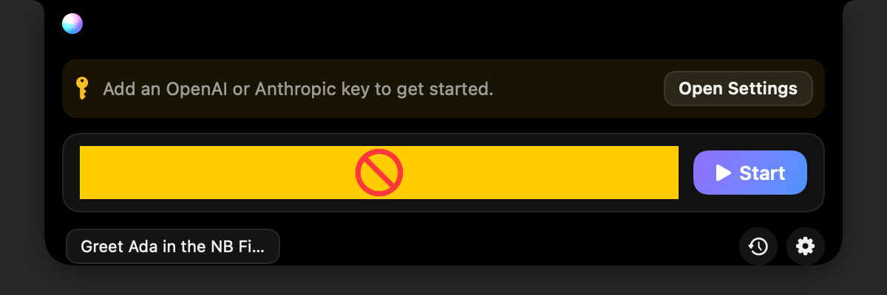
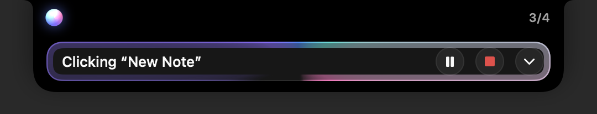
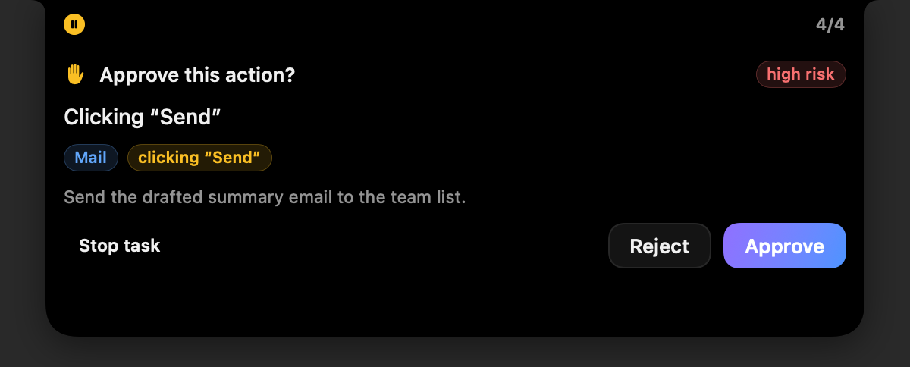
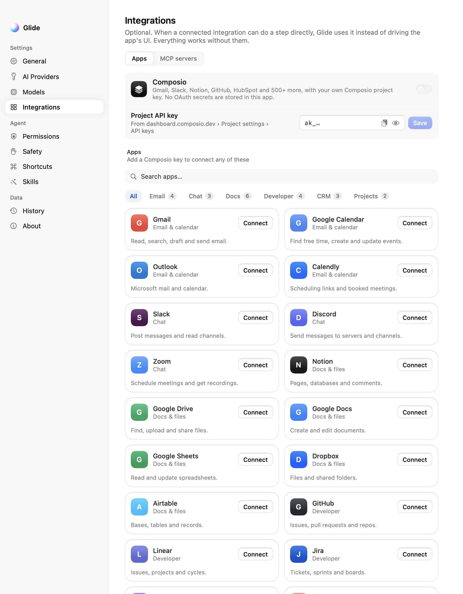
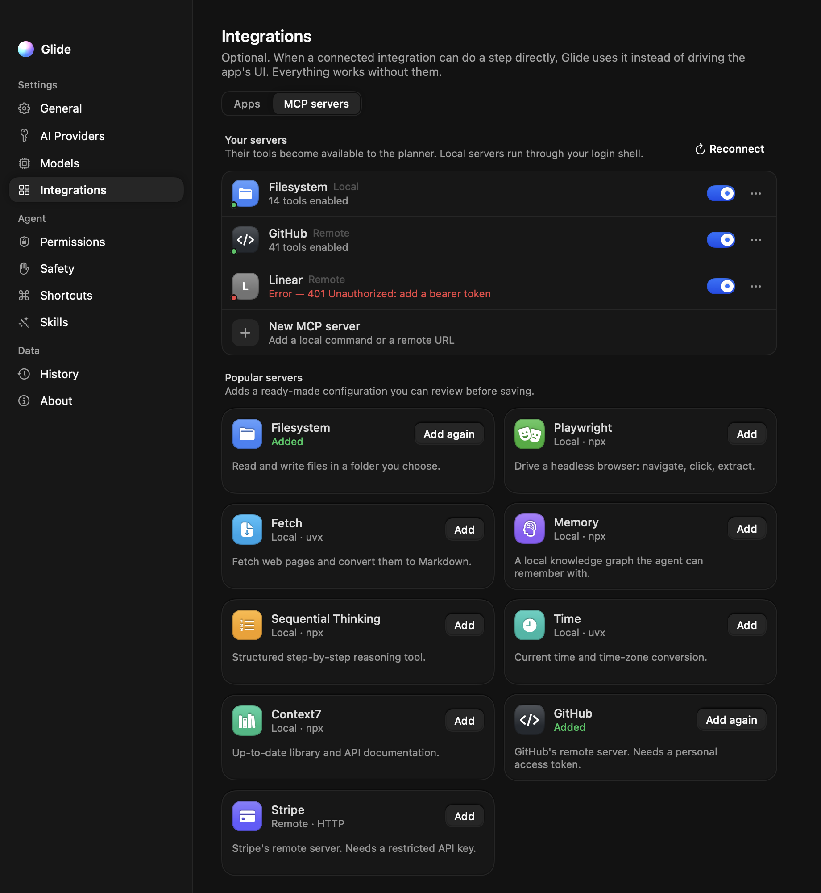
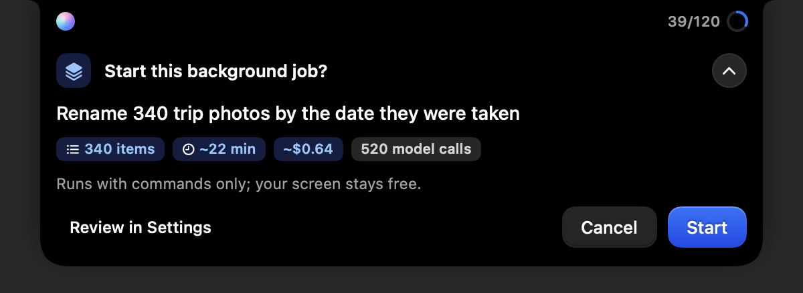
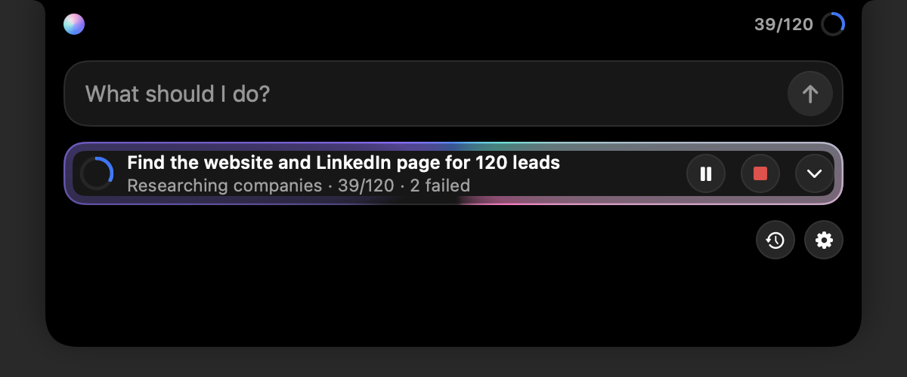
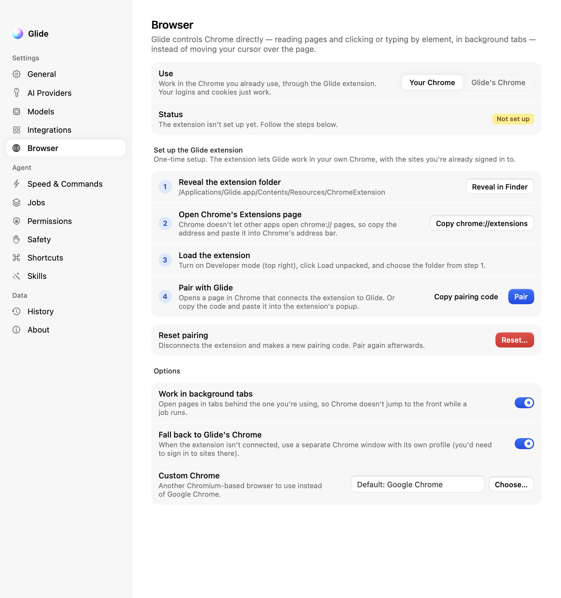

# Glide

A native macOS computer-use agent that lives in the MacBook notch.

Describe what you want done and press **Start**. Glide does each step the fastest way it can: a shell command or AppleScript, a direct read or write of a file or spreadsheet, a web fetch, or a Chrome tab it controls at the DOM level in the background. It moves the real cursor only for steps that need an app's interface. Then it reads the app's **accessibility tree** to find controls (fast, precise, no screenshots), and falls back to local OCR, and then to a vision model, only for controls accessibility can't see.

Long or repetitive work, such as going through every row of a spreadsheet, runs as a background **job** that saves its progress after every item and can be paused and resumed.

- **Native**: Swift 6, SwiftUI and AppKit, with no Electron or web runtime. Idle CPU is near zero.
- **Direct when possible**: commands, scripts, files, CSV and Excel files, web search and fetch, and DOM-level Chrome control (your own Chrome through the Glide extension, or Glide's own Chrome window). Your screen stays free.
- **Long tasks**: background jobs with loops over items, retries, waits and schedules, budgets, and a report at the end.
- **Bring your own keys**: OpenAI, Anthropic or any OpenAI-compatible endpoint (Ollama, LM Studio, OpenRouter…). Keys are stored in the macOS Keychain.
- **You stay in control**: sending, deleting, publishing and purchasing wait for your approval. Every command, script and browser action is checked by fixed rules before it runs, and some (such as `sudo`) are always blocked. A global emergency stop works even when the UI is hidden, and moving the mouse pauses the agent.
- **Local-first**: there's no account and no Glide server. Task history and jobs stay on your Mac.
- **Optional Jev**: TypeSafe's decision model breaks ties between similar on-screen controls. You can call it directly or through Vercel AI Gateway.
- **Optional integrations**: [Composio](https://composio.dev) (Gmail, Calendar, Slack, Notion, GitHub…) and any MCP server.

| Task input | Running | Approval |
|---|---|---|
|  |  |  |

| Integrations | MCP servers |
|---|---|
|  |  |

> Status: v1.0. See [docs/LIMITATIONS.md](docs/LIMITATIONS.md) for what it can't do yet.

## Requirements

- macOS 26 or later (Apple silicon or Intel)
- Xcode 26+ / Swift 6.2+ toolchain to build
- An API key for OpenAI or Anthropic, or a local OpenAI-compatible server
- Google Chrome (or Chromium), only for the browser tools

## Install from source

```bash
git clone https://github.com/yugenchokshi/Glide.git
cd Glide
./scripts/build_app.sh          # builds and signs build/Glide.app
open build/Glide.app
```

`build_app.sh` signs with `$NB_SIGN_IDENTITY`. If that's unset, it uses your first *Developer ID Application* or *Apple Development* identity, and falls back to ad-hoc signing. A stable identity matters because macOS ties the Accessibility grant to the code signature. With ad-hoc signing you'll have to re-grant Accessibility after every rebuild. `scripts/notarize.sh` notarizes a Developer ID build for distribution. The script also copies the Chrome extension into `Glide.app/Contents/Resources/ChromeExtension`.

## First run

The setup assistant walks you through:

1. Granting **Accessibility** (required) and **Screen Recording** (optional; used for the OCR and vision fallbacks).
2. Choosing a provider and pasting an API key (⌘V or the clipboard button). OpenAI uses `gpt-6-luna` by default. The key is tested on the spot and stored in your Keychain.
3. Reviewing the automatically chosen models.
4. Running a safe first task, which types one line into a new TextEdit document.

You never edit `.env` files or use the terminal.

## Using it

| Action | Default shortcut |
|---|---|
| Open the notch | **⌥ Space** (or click the notch / menu-bar icon) |
| Pause / resume | **⌥⇧ Space** |
| Emergency stop | **⌃⌥⌘ .** (works even with the UI hidden; also halts background jobs) |

Type a task such as *"Open Safari, search for the latest Apple earnings, summarize the results, and save the summary in Notes"* and press Return. The notch shows the current step. Expand it to see the plan and a live activity timeline. High-risk actions expand the notch with **Approve / Reject / Stop**. Results stay in **History**, and successful runs can be saved as reusable **Skills**.

All shortcuts can be changed in Settings › Shortcuts, which also reports conflicts with shortcuts other apps already use.

**Settings › Speed & Commands** decides how Glide works:

- **Execution**: *Fastest* (the default) prefers commands, files, background browser tabs and web fetches. *Show me* prefers driving apps on screen so you can watch.
- **Command access**: *Off*, *Read-only* (only commands that can't change anything), or *Full* (the default; changes follow your approval settings, and dangerous commands are always blocked). AppleScript and Shortcuts have their own switches.
- **Batch actions**: the model may return several actions per call (6 by default). A batch stops at the first error or unexpected change.

## Long tasks

When a request is long or repetitive (many items, waits or schedules, or more than about ten minutes of work), the planner hands it to the job engine instead of running it in the foreground. A job is a plan of milestones. Each step is a single action, a loop over items (rows of a CSV or Excel file, a list, or an earlier step's output), or a wait (a duration, a time, every day at a time, or until a condition is true).

- **Resumable.** Progress is saved after every item. A job that was running when Glide quit continues when Glide starts again (or waits, paused, if you turn off *Resume interrupted jobs*).
- **Parallel where it's safe.** Loops run up to 4 items at once for command, web and data steps, 2 for browser steps, and 1 when a step needs the screen. Failed items are retried, and the job pauses to ask when too many fail.
- **One cursor.** Only one thing uses the screen at a time, and tasks you start go first. By default a job's on-screen steps wait until you've left the mouse and keyboard alone for 30 seconds.
- **Budgets.** Each job has a cost, time and model-call budget (by default $5, 4 hours of work and 2,000 calls). It pauses and asks before going past one, and also when it seems stuck. Jobs estimated above $1 or 15 minutes wait for you to press **Start**.
- **Results.** Item results go into a table you can export as CSV. When you ask Glide to fill in your spreadsheet, it asks once before writing and keeps a `.bak` copy of the original. A finished job writes a `report.md` in its folder.
- **Control.** The notch shows progress with pause and stop. Settings › Jobs has the plan, items, activity log, usage and the job folder, plus Start, Pause, Resume, Stop, Retry failed, Export CSV and Delete. The emergency stop pauses every job so you can resume it later.
- **Awake.** While a job runs, Glide keeps the Mac from idle-sleeping (the display can still turn off).

Jobs live in `~/Library/Application Support/Glide/` (the `glide.sqlite` database, plus one folder per job under `Jobs/<id>/`).

| Confirm a big job | A job running in the background |
|---|---|
|  |  |

## Browser

Browser steps don't move the cursor. Glide speaks the Chrome DevTools Protocol to background tabs: it reads a page as a list of elements (`b12 button "Sign in"`), clicks with real mouse events, types, picks options, presses keys, scrolls, waits and reads text. It can reach Chrome in two ways:

| | Your Chrome (Glide extension) | Glide's own Chrome |
|---|---|---|
| Profile | Your everyday Chrome, with your logins | A separate profile in `~/Library/Application Support/Glide/GlideChrome`; sign in to sites there once |
| Setup | Load the extension and pair it (below) | None; it opens when a task needs it |
| When | The default | When chosen in Settings › Browser, or as a fallback while the extension isn't connected (*Fall back to Glide's Chrome*, on by default) |

To install the extension:

1. Open **Settings › Browser** and click **Reveal in Finder**. In the app the folder is `Glide.app/Contents/Resources/ChromeExtension`; when you run from a checkout it's `Extensions/chrome`.
2. In Chrome, go to `chrome://extensions`. Chrome won't open that address from another app, so Glide copies it for you to paste.
3. Turn on **Developer mode**, click **Load unpacked** and choose the folder.
4. Back in Glide, click **Pair**. Chrome opens the extension's pairing page and connects. If that page doesn't open, click **Copy pairing code** and paste it into the extension's toolbar popup.

The extension connects only to Glide on `127.0.0.1` (port 47823 by default), and both sides prove they know the pairing secret before any command runs. While Glide works in one of your tabs, Chrome shows its "started debugging this browser" bar. Closing that bar stops Glide from working in your tabs until you click **Allow again** in the extension's popup. See [SECURITY.md](SECURITY.md#browser) and [Extensions/chrome/README.md](Extensions/chrome/README.md).



## How it works

```
Notch UI → TaskController → Planner (capable model) → plan with a route per step
   quick task → ExecutionOrchestrator          long task → JobCenter → JobRunner (milestones, loops, waits)
   both run each step through StepRouter:
     command · browser · web · data · composio · mcp · answer → ToolStepRunner
         fast model returns a batch of tool calls → fixed-rule risk check → approval if needed
         → run (shell, AppleScript, files, CSV/XLSX, HTTP, Chrome over CDP) → results back to the model
     gui · native → GUIStepRunner (only while holding the screen lease)
         observe (AX tree → element graph, OCR if sparse)
         → resolve (plan hint, deterministic match, fast action model, Jev, vision)
         → safety policy → approval if needed
         → act (real CGEvent cursor/keyboard, or AX action)
         → verify (AX values, focus, windows, files)
   on failure: quick tasks retry → replan (recovery model) → explain
               jobs retry the item → pause and ask when too many fail or progress stops
```

See [ARCHITECTURE.md](ARCHITECTURE.md) for the module map and [docs/LONG_TASKS_DESIGN.md](docs/LONG_TASKS_DESIGN.md) for the design of jobs and tools.

## Command-line companion

`glidectl` drives the same engine without the UI. It's useful for development and benchmarks:

```bash
swift build
.build/debug/glidectl inspect Notes          # print the indexed UI skeleton of Notes
.build/debug/glidectl click "New Note" --app Notes
.build/debug/glidectl workflow               # Finder + Notes deterministic workflow
.build/debug/glidectl bench --json bench.json  # 12-scenario live benchmark
.build/debug/glidectl run "Open TextEdit and type hello"   # full agent with your configured provider

.build/debug/glidectl tool list [--category browser]       # every tool the agent can call
.build/debug/glidectl tool run shell.run '{"command":"echo hi"}'   # run one tool, safety-checked
.build/debug/glidectl tool run browser.open '{"url":"https://example.com"}' --headless
.build/debug/glidectl browser status                       # which Chrome backend is available
.build/debug/glidectl job run "<task>"                     # plan a job, confirm the estimate, follow it
.build/debug/glidectl job list
.build/debug/glidectl job show <id>
.build/debug/glidectl job resume <id>
```

`glidectl` shares settings, Keychain entries and the job database with the app. Only the UI commands (`inspect`, `click`, `type`, `key`, `menu`, `workflow`, `bench`, `run`) need Accessibility permission for the terminal that runs it.

- `tool run` checks the call like the agent would: blocked calls don't run, and calls that need approval ask first (`--yes` approves them). `--json` also prints the tool's structured result.
- The app owns the extension's port, so `glidectl` always uses Glide's own Chrome. `--headless` uses a throwaway headless profile instead and closes it afterwards.
- `glidectl run` always runs a request as a quick task; `job run` plans it as a background job. `job run` and `job resume` accept `--mock-url` and `--yes` like `run`. Press Ctrl-C to halt a job: it ends paused, and `job resume <id>` continues it. Job ids can be shortened to the first 8 characters `job list` prints.

Regenerate these images with `.build/debug/Glide --snapshot docs/images` (notch) and `.build/debug/Glide --snapshot-settings <dir>` (settings and onboarding).

## Tests

```bash
swift build && swift test        # unit + integration tests (no UI control, no paid APIs)
.build/debug/glidectl bench         # live benchmark: moves your real cursor on disposable fixtures
```

The browser tests start headless Chrome with a temporary profile when Chrome is installed, and skip otherwise. [docs/TESTING.md](docs/TESTING.md) also shows how to run a whole background job against the scripted mock model, including halting and resuming it.

## Privacy and security

- API keys live only in the Keychain. They are never logged, written to SQLite, or put in prompts.
- Screenshots are taken only when accessibility and local OCR can't find a control, after you allow it. Password fields are blacked out, and nothing is retained unless you turn on debug recording.
- Password fields, payment card numbers and apps on your exclusion list are never touched. The browser tools also refuse to type into password fields or enter card numbers.
- Commands, scripts, file operations and browser actions are judged by fixed rules before they run, never by the model. Deleting, overwriting, sending and uploading ask first. `sudo`, erasing disks and piping downloads into a shell are always blocked.
- The Chrome extension talks only to Glide on `127.0.0.1`, and the pairing secret never goes over the connection.

Details are in [SECURITY.md](SECURITY.md).

## Design

The interface follows [BoardUI](https://www.boardui.com)'s visual language: its neutral surfaces and blue accent, grouped settings rows, pastel chips, and its agent-progress, thinking and composer-loader patterns. BoardUI is a React/Tailwind library, so it is re-created natively in SwiftUI as "BoardKit" (`Sources/GlideApp/BoardKit`). No BoardUI source or assets are included. See [docs/DESIGN.md](docs/DESIGN.md).

## License

MIT. See [LICENSE](LICENSE). Glide has no third-party package dependencies and links only Apple system frameworks and the system SQLite. The Chrome extension is plain JavaScript with no dependencies or build step.
